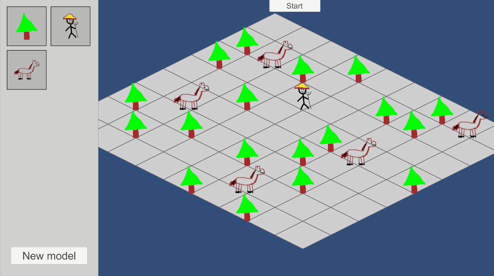
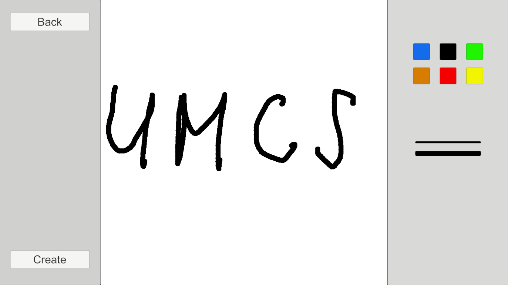

# Sandbox Notebook Game

A 2D isometric sandbox built in **Unity 6** and **C#**. Instead of using ready-made art, you **draw every object yourself**: a player, NPCs and obstacles. Then you place them on a tilemap and start a simulation where characters find paths around your drawings and react to each other.

This project is my **BSc thesis** in Computer Science at Maria Curie-Skłodowska University (UMCS), Lublin, 2025:
*"Algorithms used in sandbox games and their implementation on the Unity platform"* ([PDF, Polish](thesis/thesis.pdf)).



## How it works

1. **Draw**: sketch a sprite on the drawing canvas and choose its role: *Player*, *NPC* or *Physical object* (obstacle).
2. **Build**: place your sprites on the isometric tilemap.
3. **Simulate**: press **Start**. The player walks to wherever you click, NPCs wander around, and obstacles block movement.



## Algorithms and techniques

| Area                | Implementation                                                                                                                                                                                                                         |
| ------------------- | -------------------------------------------------------------------------------------------------------------------------------------------------------------------------------------------------------------------------------------- |
| **Pathfinding**     | A* on the tile grid with 8-directional movement, integer move costs (10 / 14), the octile-distance heuristic and corner-cutting prevention. It uses a custom binary-heap priority queue.                                               |
| **NPC behaviour**   | A finite state machine (`INPCState` with `Enter / Update / Exit`) with three states. **Idle** waits for a random time. **Patrol** walks to a random reachable cell nearby. **Flee** is triggered when the player clicks an NPC.        |
| **Flee logic**      | Samples directions within ±90° away from the threat, keeps only targets that A* can reach, and picks the one that ends up farthest from the player.                                                                                    |
| **Walkability**     | A walkability grid is built from the tilemap bounds and placed obstacles, and it is rebuilt every time a simulation starts.                                                                                                            |
| **Drawing**         | Brush strokes are rasterised into a `Texture2D` by interpolating circles between mouse samples. The result is auto-cropped to its bounding box and converted into a sprite at runtime. It supports colours, brush sizes and an eraser. |
| **Object creation** | A factory (`ObjectFactory`) holds the drawn object templates (`ScriptableObject`s). `TilemapPlacer` instantiates them and attaches the right controller (`PlayerController` / `NPCController`) based on the object's role.             |

## Controls

| Mode | Action |
|---|---|
| Drawing | **LMB**: draw · **Q**: toggle eraser · colour and size buttons · **Create**: save the sprite |
| Editing | Pick a sprite from the left panel · **LMB**: place it on a tile · **RMB**: remove it · only one player is allowed |
| Simulation | **LMB**: move the player (A*) · **click an NPC**: make it flee · **Start / Stop**: toggle the simulation |

## Project structure

```
Assets/
├── Scenes/EditingScene.unity        # main scene
├── Scripts/
│   ├── AStarPathfinder.cs           # A* pathfinding
│   ├── PriorityQueue.cs             # binary min-heap
│   ├── WalkableGridGenerator.cs     # walkability grid
│   ├── NPCController.cs, NPCStateMachine.cs
│   ├── MachineStates/               # Idle, Patrol, Flee states
│   ├── PlayerController.cs          # click-to-move player
│   ├── DrawingPanelManager.cs       # drawing canvas, texture → sprite
│   ├── ObjectFactory.cs, TilemapPlacer.cs
│   └── GameModeManager.cs           # switching between drawing / editing / simulation
└── ScriptableObjects/               # ObjectSO, DrawingLineSO
thesis/                              # thesis source (LaTeX) and PDF
```

## Running the project

1. Install **Unity 6 (6000.0 LTS)** through Unity Hub. Any recent 6000.0.x patch works.
2. Clone the repository and open the folder in Unity Hub (**Add → Add project from disk**).
3. Open `Assets/Scenes/EditingScene.unity` and press **Play**.
## Tech stack

Unity 6 · C# · Universal Render Pipeline · Tilemap · ScriptableObjects · uGUI
